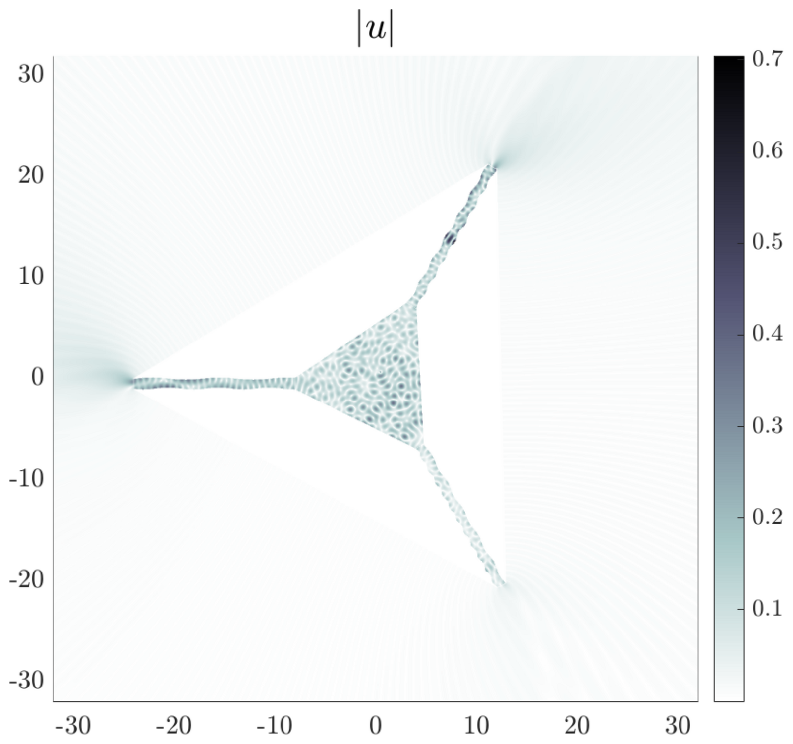
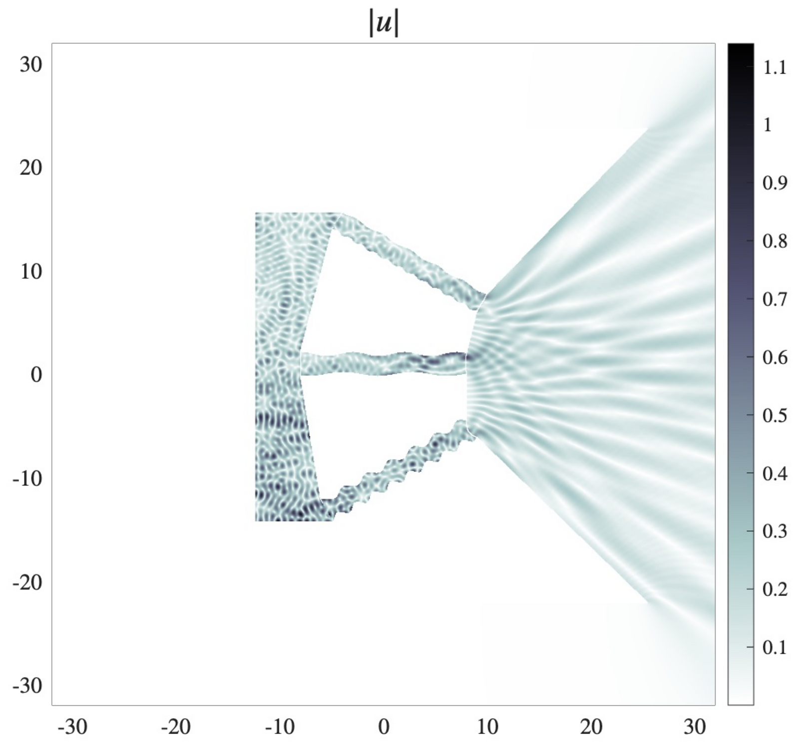
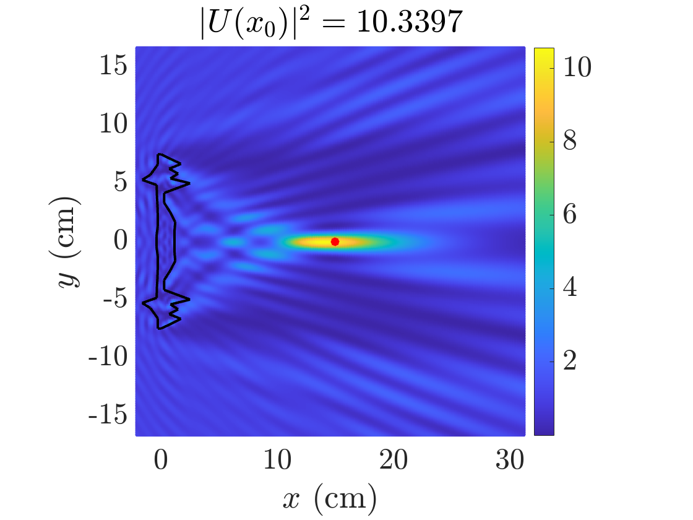
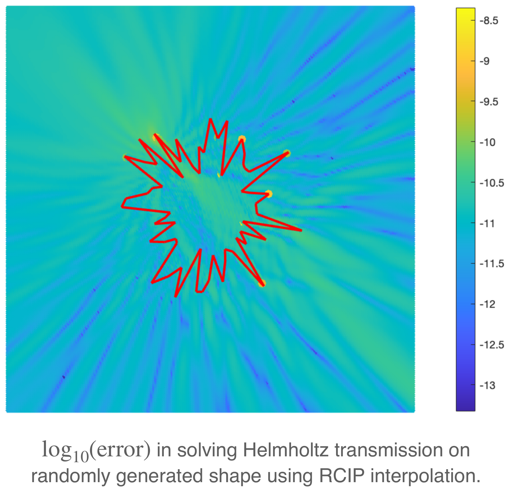
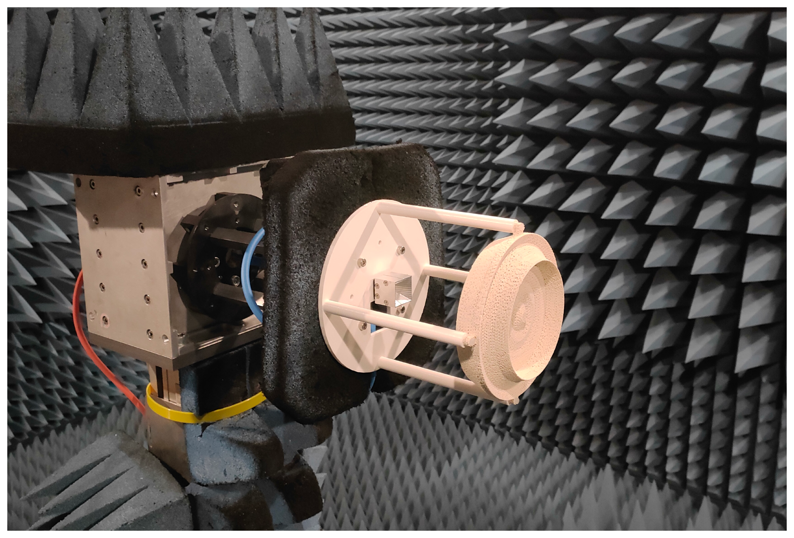
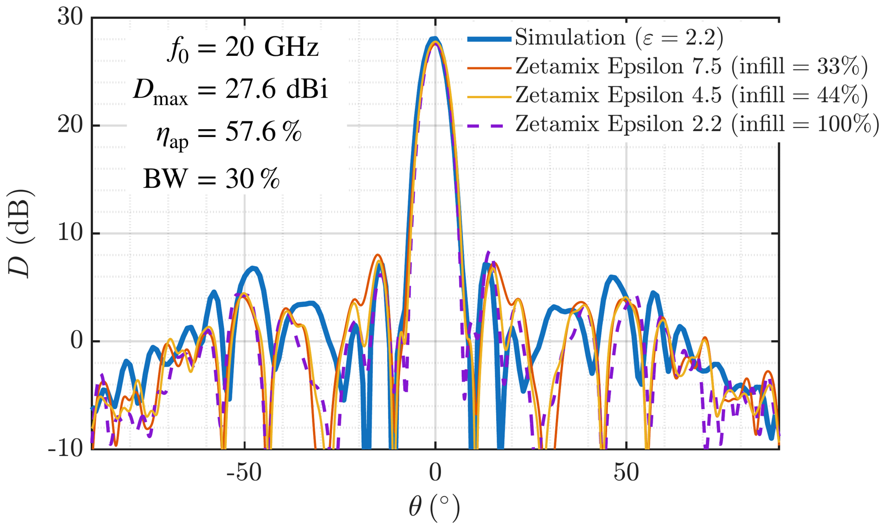

### Generalized Impedance Boundary Conditions for Wave Problems
For many problems in both electromagnetics (e.g. thin dielectric coatings, imperfect conductors) and acoustics (e.g. ultrasonics, strong absorbers, viscothermal acoustics), a certain physical effect is localized in a thin layer along the boundary of the domain. Asymptotic expansions can be used to approximate the effect of the layer by a generalized impedance boundary condition (GIBC) imposed on the boundary. Our method also accommodates standard domain decomposition problems, where the GIBC is imposed on the walls of a channel and an impedance boundary condition is imposed on artificial curves at the ends of the waveguide. The second order derivatives in the GIBC, combined with the corners in the geometry, give rise to singularities that require attention. We cancel these singularities by first preconditioning with the surface Neumann Green's function, then employing a method of "fins" inspired by the classic method of images.

  
  

### Efficient Shape Optimization for Lens Design
Telecommunications technologies, particularly in recent years, require lenses and antennas that, in addition to having high field intensity and low loss up to high frequency, satisfy certain constraints and perform custom tasks. Though there is an expansive literature on the design of lenses with inhomogeneous refractive index, there is relatively little devoted to the development of design methods for homogeneous lenses. We design our lenses using shape optimization, attaining extremely high accuracy at each iteration and using the classic adjoint method to obtain the entire gradient in one linear solve. The space of geometries with piecewise linear boundary offers both simplicity and flexibility. In particular, it makes it easy to obtain Fresnel-type lenses, which are of particular interest when the lens is desired to be compact or lightweight. To obtain accuracy in the presence of corners, we use recursively compressed inverse preconditioning (RCIP), a method due to Johan Helsing. The corrections at each corner due to RCIP or expensive to compute, so we precompute a table of corrections and interpolate to the required corrections at optimization time.

  
  

  
  

